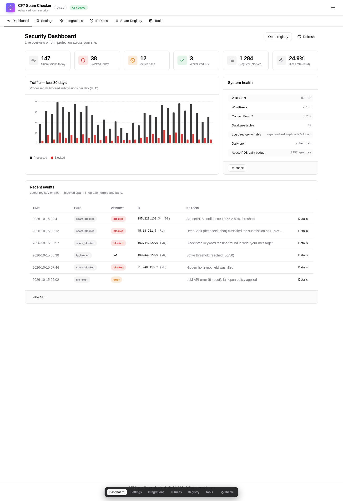
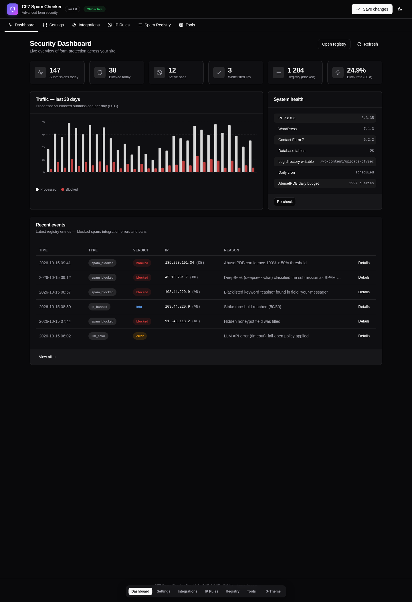
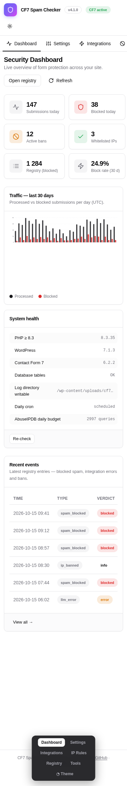
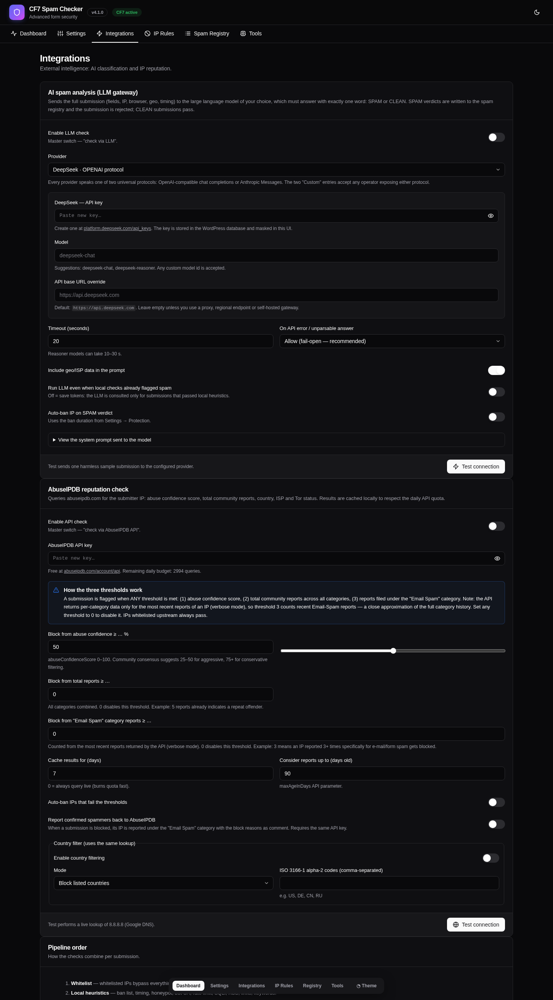
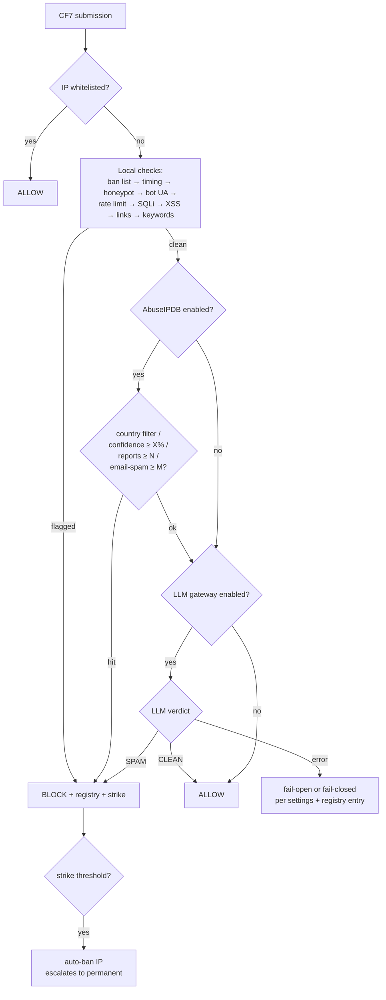

# Spam Checker Pro for Contact Form 7

[](https://php.net/)
[](https://wordpress.org/)
[](LICENSE.txt)
[](https://github.com/paulmann/Contact-Form-7-LLM-Spam-Checker/actions/workflows/ci.yml)

**Multi-layered spam & security protection for Contact Form 7** — silent, zero-UI for your visitors, ruthless to bots.

Combines behavioural analysis (timing + honeypot), content inspection (SQLi/XSS/link/keyword signatures), network reputation (**AbuseIPDB**) and **AI classification (LLM gateway, 11 providers)** into a single, ordered pipeline. Everything is stored in purpose-built database tables, fully translatable (**EN / RU / ZH / DE**) and managed from a modern, mobile-first admin dashboard with light/dark themes.

> **Русская документация:** [README.ru.md](README.ru.md)

## Screenshots

| Light theme | Dark theme |
|---|---|
|  |  |
|  |  |

*Interactive standalone preview of every admin page (light/dark): open `docs/preview/admin-ui-preview.html` in a browser (self-contained, no server needed), or use the built-in theme toggle right in wp-admin after install.*

---

## Table of Contents

- [Why](#why)
- [Features](#features)
- [How it works](#how-it-works)
- [Requirements](#requirements)
- [Installation](#installation)
- [Quick start](#quick-start)
- [LLM gateway setup](#llm-gateway-setup-deepseek-chatgpt-qwen-claude-)
- [AbuseIPDB setup](#abuseipdb-setup)
- [Privacy](#privacy)
- [Admin dashboard](#admin-dashboard)
- [Developer reference](#developer-reference)
- [Architecture](#architecture)
- [Upgrading from v3.x](#upgrading-from-v3x)
- [Development](#development)
- [License](#license)

---

## Why

CAPTCHAs punish your visitors. Most "anti-spam" plugins stop at a honeypot. Real form spam in 2026 comes from LLM-driven bots, rotating residential proxies and Tor exit nodes — defeating it takes **layered signals**: behavioural, structural, reputational and semantic.

Spam Checker Pro for Contact Form 7 runs those layers in cost-aware order: free local heuristics first, paid/cloud APIs only when the submission still looks clean. Legit users are never challenged; spammers are logged to an auditable **spam registry** with the exact evidence that condemned them.

## Features

### Protection layers

| # | Layer | Type | Description |
|---|-------|------|-------------|
| 0 | Whitelist | local | Whitelisted IPs bypass everything |
| 1 | IP ban list | local | Instant rejection of banned IPs (auto/manual/reputation) |
| 2 | Timing analysis | local | Human dwell-time measured client-side (monotonic timer — immune to clock skew **and page caches**); server-timestamp fallback with skew tolerance |
| 3 | Honeypot | local | Per-form invisible field |
| 4 | Bot user-agent | local | 60+ automation markers, headless browsers, scanners — with false-positive suppression for real browser names |
| 5 | Rate limiting | local | 60-second window per IP (atomic counter) |
| 6 | SQL-injection | local | Context-aware signatures (UNION SELECT, tautologies, stacked queries, system catalog probes…) tuned against false positives |
| 7 | XSS | local | Script tags, event handlers, dangerous URIs — including HTML-entity and URL-decoded variants |
| 8 | Link spam | local | Configurable max links per field |
| 9 | Keyword blacklist | local | Admin-editable, multibyte, case-insensitive |
| 10 | Country filter | API | Block/allow by country via AbuseIPDB geo data |
| 11 | AbuseIPDB | API | Abuse-confidence score, total reports **and per-category "Email Spam" report counting** (verbose mode) |
| 12 | LLM gateway | AI | Full-submission semantic analysis → strict `SPAM` / `CLEAN` verdict via **11 providers**: DeepSeek, OpenAI (ChatGPT), Qwen, Anthropic Claude, Google Gemini, Groq, Mistral, OpenRouter, xAI Grok + any custom OpenAI-compatible or Anthropic-compatible endpoint |
| — | Language validation | field | 22-language character-set validation on name fields with friendly per-field errors |

### Platform

- **Spam registry** — searchable DB log of every verdict with full evidence (per-check results, sanitized payload, UA, referrer), CSV export, retention policy (GDPR-ready).
- **IP management** — bans + whitelist in one table, strike escalation (N-th ban becomes permanent), manual bans refuse private/reserved ranges, bulk delete, CSV export, on-demand AbuseIPDB lookup per row.
- **LLM gateway** — one configuration surface for eleven providers over two universal protocols (OpenAI-compatible chat completions, Anthropic Messages): per-provider API keys (masked in UI), free-text model ids with suggestions, base-URL overrides for proxies/regional endpoints, timeout, fail-open/fail-closed policy, optional auto-ban on SPAM verdict, built-in connection tester.
- **AbuseIPDB integration** — three independent thresholds (confidence %, total reports, Email-Spam-category reports), DB-backed response cache with configurable TTL, live daily-quota tracking from API headers, optional **auto-reporting of confirmed spammers** back to the community (category 10 "Email Spam").
- **Modern admin UI** — Tailwind-based design system with shadcn/ui-style tokens, full **light/dark/system theme** (persisted, auto-detected on first visit), responsive down to 360 px, **zero CDN dependencies** (everything ships locally).
- **i18n** — English, Russian (ru_RU), Simplified Chinese (zh_CN), German (de_DE); every string translatable, visitor-facing messages customizable per check.
- **Notifications** — throttled e-mail alerts for bans, spam waves and integration errors.
- **Ops tooling** — settings export/import (JSON), health page, debug log viewer, one-click maintenance (cron also runs daily), clean `uninstall.php`.
- **REST-first admin** — all UI actions go through a nonce-protected `cf7sec/v1` REST namespace with `manage_options` capability gates.

## How it works



Design rules:

1. **Fail open on internal errors** — a security plugin must never take down your contact form. Exceptions are caught, logged and reported in the registry.
2. **Remote checks run last and only while the submission is still clean** — saves API quota and LLM tokens (configurable).
3. **Every verdict carries evidence** — the registry stores per-check results, so false positives are diagnosable in one click.

## Requirements

- WordPress **6.0 – 7.1+**
- PHP **8.3 – 8.5+** (strict types, readonly properties, enums)
- [Contact Form 7](https://wordpress.org/plugins/contact-form-7/) **5.7+** (tested with 6.2)
- Optional: an API key for any of the [11 LLM providers](#llm-gateway-setup-deepseek-chatgpt-qwen-claude-), [AbuseIPDB API key](https://www.abuseipdb.com/account/api)

The plugin degrades gracefully: without CF7 it shows a notice and waits; without API keys the local layers keep working.

## Installation

### From WordPress.org (once published)

1. *Plugins → Add New* → search **"Spam Checker Pro for Contact Form 7"** → Install → Activate.

### Manual / GitHub release

1. Download `spam-checker-for-contact-form-7.zip` from [Releases](https://github.com/paulmann/Contact-Form-7-LLM-Spam-Checker/releases).
2. *Plugins → Add New → Upload Plugin* → choose the ZIP → Activate.

Activation creates four tables (`{prefix}cf7sec_events`, `…_ip_rules`, `…_geo`, `…_daily`), schedules a daily maintenance cron and — if you used v3.x — migrates your legacy settings and `ban_list.json` automatically.

## Quick start

1. Go to **CF7 Security → Settings → Protection** and review the layers (sane defaults are already on).
2. Open **Integrations** and add your LLM provider and/or AbuseIPDB keys; press **Test connection** for each.
3. Submit your contact form once — check **Spam Registry** and the **Dashboard** chart.
4. Set the visitor-facing texts under **Settings → Messages** if you want something friendlier than the CF7 default.

No form tags or template changes are required — protection is injected automatically via hidden fields and the `wpcf7_spam` pipeline.

## LLM gateway setup (DeepSeek, ChatGPT, Qwen, Claude, Gemini, …)

1. Pick a provider on **Integrations → AI spam analysis** and create a key:
   | Provider | Protocol | Key |
   |---|---|---|
   | DeepSeek | OpenAI | [platform.deepseek.com](https://platform.deepseek.com/api_keys) |
   | OpenAI (ChatGPT) | OpenAI | [platform.openai.com](https://platform.openai.com/api-keys) |
   | Qwen (DashScope) | OpenAI | [alibabacloud.com](https://www.alibabacloud.com/product/modelstudio) |
   | Anthropic (Claude) | Anthropic | [console.anthropic.com](https://console.anthropic.com/settings/keys) |
   | Google Gemini | OpenAI | [aistudio.google.com](https://aistudio.google.com/apikey) |
   | Groq / Mistral / OpenRouter / xAI | OpenAI | provider console |
   | Custom (any operator) | OpenAI **or** Anthropic | your gateway |
2. Paste the key (stored in the WP database, masked in the UI), choose or type a model id, optionally override the base URL (proxies, self-hosted vLLM/Ollama, regional endpoints), and switch on **Enable LLM check**.
3. Press **Test connection** — the plugin sends one harmless sample submission and shows the provider's verdict and latency.

What gets sent: a structured digest of the submission — all field values, client IP, country/ISP (when AbuseIPDB data is available), user-agent, referrer, human dwell time and the results of the local heuristics. The system prompt (viewable in the UI) forces a one-word answer: `SPAM` or `CLEAN`.

- `SPAM` → submission rejected, written to the registry (optionally bans the IP).
- `CLEAN` → submission passes.
- API/parse error → your choice of **fail-open** (default — allow, log error) or **fail-closed** (block).

## AbuseIPDB setup

1. Get a free key at [abuseipdb.com/account/api](https://www.abuseipdb.com/account/api).
2. **Integrations → AbuseIPDB reputation check**: paste the key, switch on **Enable API check**.
3. Configure thresholds — a submission is blocked when **any** is met:
   - **Abuse confidence ≥ X %** (community consensus: 25–50 aggressive, 75+ conservative; default 50);
   - **Total reports ≥ N** (all categories; 0 = disabled);
   - **"Email Spam" category reports ≥ M** (0 = disabled).
4. Optional: auto-ban offenders, report confirmed spammers back (category 10, with block reasons as comment), country block/allow-list.
5. **Test connection** performs a live lookup of 8.8.8.8.

**About per-category counts:** the public Check API does not expose lifetime per-category counters, but in `verbose` mode it returns the most recent individual reports *with their categories* — the plugin counts "Email Spam" (category 10) entries among them. This is a close approximation and documented as such in the UI.

Quota safety: responses are cached in a DB table for a configurable TTL (default 7 days), the plugin tracks the remaining daily budget from the API's own `x-ratelimit-remaining` header, and remote checks run only for submissions that passed local heuristics.

## Privacy

Nothing leaves your site until you opt in. Both integrations ship **disabled**; without an API key no data is ever transmitted, and neither integration is enabled implicitly by installing or updating the plugin.

| Where | What leaves your site | When |
|---|---|---|
| Your own database | Blocked submissions (verdict, IP, country, reasons, per-check evidence, payload) | Always, kept for the configured retention period |
| `wp-content/uploads/cf7sec/` | Debug log lines | Only if you switch debug logging on |
| `abuseipdb.com` | The submitter's IP address, to read its abuse-confidence score and report counts. If community reporting is enabled, the IP of a confirmed spammer is submitted back | Only if the AbuseIPDB integration is enabled with an API key |
| One LLM provider of your choice | The submission digest: every form field value, the submitter IP, country/ISP when available, user agent, referrer, human dwell time and the local check results | Only if the LLM gateway is enabled with an API key |

The provider that receives the digest is exactly the one you select — DeepSeek, OpenAI (ChatGPT), Qwen (Alibaba DashScope, `dashscope.aliyuncs.com` / `dashscope-intl.aliyuncs.com`), Anthropic Claude (`api.anthropic.com`), Google Gemini (`generativelanguage.googleapis.com`), Groq (`api.groq.com`), Mistral AI (`api.mistral.ai`), OpenRouter (`openrouter.ai`), xAI Grok (`api.x.ai`), or a custom OpenAI-compatible / Anthropic-compatible endpoint whose base URL you supply yourself.

Uninstalling removes all plugin data unless **Keep data on uninstall** is enabled. See `readme.txt` for the same disclosure in the directory listing format.

## Admin dashboard

| Page | What you do there |
|------|-------------------|
| **Dashboard** | Today/30-day KPIs, processed-vs-blocked chart, system health, recent events |
| **Settings** | General (scope, retention, IP detection), Protection (all 10 local layers + parameters), Messages, Notifications, Diagnostics (debug log viewer) |
| **Integrations** | LLM gateway + AbuseIPDB configuration & self-tests, pipeline order card |
| **IP Rules** | Ban list & whitelist: add/search/delete/bulk-delete, strikes, expiry, CSV export, per-IP AbuseIPDB lookup |
| **Spam Registry** | Filter by verdict/type/date/text, evidence modal per event (checks, payload, UA), CSV export, purge |
| **Tools** | Settings export/import, manual maintenance, geo-cache clear, stats reset, IP lookup, requirements check, danger zone |

Theme toggle (top bar) cycles **light → dark → system**; the choice persists in `localStorage` and is auto-detected from your OS on first visit.

## Developer reference

### Filters & actions

```php
/**
 * Fires after an IP has been banned.
 * @param string $ip
 * @param string $reason
 * @param bool   $permanent
 */
do_action( 'cf7sec_ip_banned', $ip, $reason, $permanent );

/** Fires after the daily maintenance run. */
do_action( 'cf7sec_after_cleanup' );
```

The pipeline consumes the standard CF7 filters: `wpcf7_spam` (priority 5), `wpcf7_validate_{text,email,tel,textarea}` (language validation), `wpcf7_form_hidden_fields`, `wpcf7_display_message` (custom spam messages), `wpcf7_editor_panels`.

### REST API (`cf7sec/v1`)

All routes require `manage_options` + `X-WP-Nonce`:

```
GET|POST /settings          read (masked secrets) / save
POST     /settings/reset    factory defaults
GET      /stats?days=30     chart series + totals
GET      /health            environment diagnostics
GET      /events            registry list (filters: verdict, event_type, search, from, to, page)
GET      /events/{id}       event with full evidence
GET      /events/export     CSV
POST     /events/clear      truncate registry
GET|POST /ip-rules          list / add (ban|whitelist)
DELETE   /ip-rules/{ip}     remove
POST     /ip-rules/bulk-delete
POST     /ip-lookup         on-demand AbuseIPDB lookup
POST     /test/deepseek | /test/abuseipdb | /test/email
GET      /export · POST /import    settings backup
POST     /cleanup           run maintenance now
GET      /logs · /logs/dates · DELETE /logs    debug log viewer
```

### Adding a custom check

```php
use CF7Sec\Security\{CheckInterface, CheckResult, SubmissionContext};

final class MyCheck implements CheckInterface {
    public function id(): string { return 'my_check'; }
    public function label(): string { return 'My check'; }
    public function enabled(SubmissionContext $c): bool { return true; }
    public function run(SubmissionContext $c): CheckResult {
        return $c->postedData['email'] === 'spam@spam.test'
            ? CheckResult::fail('my_check', 'Known spam address', 'keyword_spam')
            : CheckResult::pass('my_check');
    }
}
```

Compose it into a pipeline by subclassing, or simply block via the standard `wpcf7_spam` filter for lightweight cases.

## Architecture

```
spam-checker-for-contact-form-7/
├── spam-checker-for-contact-form-7.php   # bootstrap: constants, PSR-4 autoloader, guards
├── uninstall.php                     # full data purge (unless keep_data)
├── src/                              # namespace CF7Sec\ (PHP 8.3+, strict types)
│   ├── Plugin.php                    # composition root, hook wiring
│   ├── Settings.php                  # schema, defaults, sanitisation, secret masking
│   ├── Activator.php / Deactivator.php / Cron.php
│   ├── Languages.php                 # 22-language regex registry
│   ├── Security/                     # SpamPipeline + CheckResult/Status/Context
│   │   ├── Checks/                   # 11 checks, one class per file
│   │   ├── Patterns.php              # SQLi/XSS/bot-UA signature registries
│   │   ├── LlmPrompt.php             # submission digest builder
│   │   └── LanguageValidator.php     # wpcf7_validate_* integration
│   ├── Services/                     # Llm gateway, AbuseIpDb, BanManager, Mailer, Logger
│   ├── Storage/                      # EventsRepository, IpRuleRepository, GeoCache, DailyStats
│   ├── Support/                      # Ip (proxy-aware resolution), mbstring compat
│   └── Admin/                        # AdminMenu, Assets, PageRenderer, RestController,
│       └── Views/pages/              # dashboard, settings, integrations, ip-rules, registry, tools
├── assets/
│   ├── src/                          # input.css (design system) + admin.js (SPA-ish UI)
│   └── dist/                         # built assets — committed, no build step needed in prod
├── languages/                        # .pot + ru_RU/zh_CN/de_DE (.po + .mo)
├── tests/                            # smoke.php (no WP) + wp-integration.php (real WP+CF7)
└── tools/                            # POT extraction + i18n/MO compiler (pure Python)
```

Storage: 4 custom tables — `cf7sec_events` (registry), `cf7sec_ip_rules` (ban/whitelist/strikes), `cf7sec_geo` (AbuseIPDB cache), `cf7sec_daily` (aggregate counters). No more JSON files in `wp-content/` (v3 legacy data is migrated on activation — and on a regular plugin update).

Full details: [docs/ARCHITECTURE.md](docs/ARCHITECTURE.md).

## Upgrading from v3.x

1. Install v4 over the old plugin (same folder name) and activate.
2. On activation the plugin automatically:
   - migrates `cf7sec_options` (feature flags, rate limits, ban duration, custom messages) into the new schema;
   - imports `wp-content/cf7sec_logs/ban_list.json` into the new `ip_rules` table (expired bans dropped) and renames it `*.migrated`;
   - keeps the old JSON files in place for reference (delete manually once satisfied).
3. Re-check **Settings → Protection** — v4 adds parameters that did not exist in v3.

Behavioural notes: hidden field names changed (`cf7sec_ts`, `cf7sec_age`, `cf7sec_hp_*`); the client-side timer is new and strictly better with page caching. The legacy `_cf7a_timestamp` check never actually received data under CF7 ≥ 5.9 (CF7 strips `_`-prefixed POST keys from `posted_data`) — v4 fixes this class of silent failures.

## Development

```bash
# assets (only needed when changing CSS/JS sources; assets/dist is committed)
npm install tailwindcss@3 --no-save
mkdir -p assets/dist
npm run build

# tests (all of them, in order)
npm test
# or individually:
php tests/smoke.php                        # pure logic, no WordPress needed
php tests/settings-paths.php               # guard: no dead settings paths (B1)
php tests/assets-built.php                 # guard: dist assets + class coverage (B3/M1)
php tests/upgrade-4.0-to-4.1.php           # guard: upgrade preserves LLM config (B2)
php tests/docs-links.php                   # guard: documentation links resolve
wp eval-file tests/wp-integration.php \
   --path=/path/to/wp                      # full stack: real WP + CF7 + MySQL
                                           # set CF7SEC_TEST_ABUSE_KEY for live API tests

# i18n (cross-platform: node tools/py.js picks python3 or python)
npm run i18n:extract                       # regenerate languages/*.pot
npm run i18n:build                         # rebuild .po/.mo from tools/i18n-*.py
```

Code style: PSR-12-ish, `declare(strict_types=1)` everywhere, PHPDoc on public APIs, no global state outside the composition root.

## License

GPL-2.0-or-later — see [LICENSE.txt](LICENSE.txt).

---

*Developed by Mikhail Deynekin — [deynekin.com](https://deynekin.com) · 2026*
