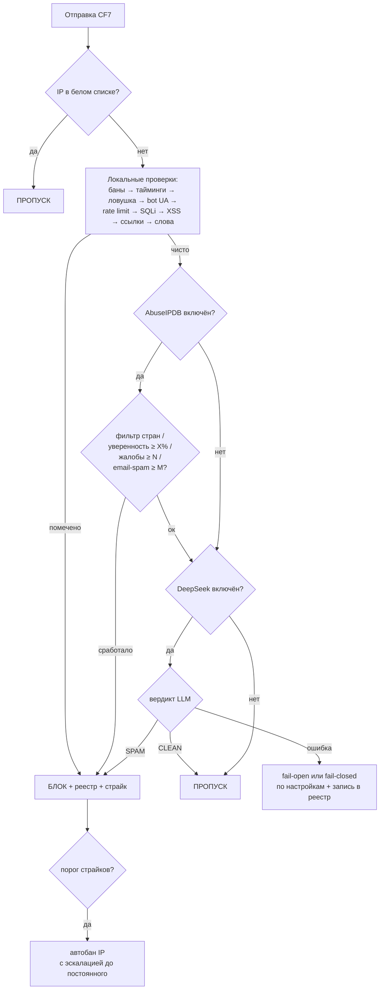

# CF7 Spam Checker Pro

[](https://php.net/)
[](https://wordpress.org/)
[](LICENSE.txt)

**Многоуровневая защита Contact Form 7 от спама и атак** — невидимая для посетителей, беспощадная к ботам.

Плагин объединяет поведенческий анализ (тайминги + ловушка), инспекцию содержимого (сигнатуры SQLi/XSS/ссылок/ключевых слов), сетевую репутацию (**AbuseIPDB**) и **ИИ-классификацию (DeepSeek LLM)** в единый упорядоченный конвейер. Все данные хранятся в собственных таблицах БД, интерфейс полностью переведён (**EN / RU / ZH / DE**), админка современная, mobile-first, со светлой и тёмной темой.

> **English documentation:** [README.md](README.md)

## Скриншоты

| Светлая тема | Тёмная тема |
|---|---|
|  |  |
|  |  |

*Интерактивный автономный предпросмотр всех страниц админки (светлая/тёмная): откройте `docs/preview/admin-ui-preview.html` в браузере (самодостаточный файл, сервер не нужен) — или переключайте тему прямо в wp-admin после установки.*

---

## Возможности

### Уровни защиты

| # | Уровень | Тип | Описание |
|---|---------|-----|----------|
| 0 | Белый список | локальный | IP из белого списка обходят все проверки |
| 1 | Список банов | локальный | Мгновенный отказ заблокированным IP |
| 2 | Анализ времени | локальный | Время заполнения формы измеряется на клиенте монотонным таймером (нечувствителен к кэшу страниц и часов); серверный fallback с допуском расхождения часов |
| 3 | Ловушка (honeypot) | локальный | Невидимое поле для каждой формы |
| 4 | Bot User-Agent | локальный | 60+ маркеров автоматизации, headless-браузеры, сканеры — с подавлением ложных срабатываний на реальных браузерах |
| 5 | Rate limiting | локальный | Скользящее 60-секундное окно на IP |
| 6 | SQL-инъекции | локальный | Контекстные сигнатуры (UNION SELECT, тавтологии, stacked-запросы, обращения к системным каталогам…) |
| 7 | XSS | локальный | Скрипты, обработчики событий, опасные URI — включая HTML-entity и URL-кодирование |
| 8 | Спам ссылками | локальный | Настраиваемый максимум ссылок на поле |
| 9 | Чёрный список слов | локальный | Редактируемый, мультибайтовый, без учёта регистра |
| 10 | Фильтр стран | API | Блокировка/разрешение стран по данным AbuseIPDB |
| 11 | AbuseIPDB | API | Оценка уверенности, общее число жалоб **и подсчёт жалоб категории «Email Spam»** (verbose-режим) |
| 12 | LLM-шлюз | ИИ | Семантический анализ всей отправки → строгий вердикт `SPAM` / `CLEAN` через **11 провайдеров**: DeepSeek, OpenAI (ChatGPT), Qwen, Anthropic Claude, Google Gemini, Groq, Mistral, OpenRouter, xAI Grok + любой свой OpenAI- или Anthropic-совместимый эндпоинт |
| — | Языковая валидация | поле | Валидация имён по 22 языкам с дружелюбными ошибками для каждого поля |

### Платформа

- **Реестр спама** — searchable-журнал каждого вердикта с полными доказательствами (результаты всех проверок, обезличенная нагрузка, UA, реферер), CSV-экспорт, политика хранения (GDPR).
- **Управление IP** — баны и белый список в одной таблице, эскалация страйков (N-й бан становится постоянным), ручные баны отказываются блокировать частные диапазоны, массовое удаление, CSV-экспорт, проверка любого IP через AbuseIPDB в один клик.
- **LLM-шлюз** — единая настройка для одиннадцати провайдеров поверх двух универсальных протоколов (OpenAI-совместимые chat completions, Anthropic Messages): отдельные ключи на провайдера (маскируются в UI), свободный ввод модели с подсказками, переопределение base URL для прокси/региональных эндпоинтов, таймаут, политика fail-open/fail-closed, опциональный автобан при вердикте SPAM, встроенный тест подключения.
- **AbuseIPDB** — три независимых порога (уверенность %, общее число жалоб, жалобы категории «Email Spam»), кэш ответов в БД с настраиваемым TTL, отслеживание дневной квоты по заголовкам API, опциональная **автоотправка жалоб на подтверждённых спамеров** обратно в сообщество (категория 10).
- **Современная админка** — дизайн-система на Tailwind с токенами в стиле shadcn/ui, **светлая/тёмная/системная тема** (сохраняется, определяется автоматически при первом визите), адаптив от 360 px, **ноль CDN-зависимостей** — всё локально.
- **i18n** — английский, русский (ru_RU), упрощённый китайский (zh_CN), немецкий (de_DE); все строки переводимы, сообщения для посетителей настраиваются для каждой проверки.
- **Уведомления** — троттлингуемые e-mail-оповещения о банах, волнах спама и ошибках интеграций.
- **Эксплуатация** — экспорт/импорт настроек (JSON), страница здоровья, просмотрщик debug-журнала, обслуживание в один клик (cron тоже ежедневно), чистый `uninstall.php`.
- **REST-first** — все действия интерфейса идут через защищённый nonce namespace `cf7sec/v1` с проверкой `manage_options`.

## Как это работает



Принципы:

1. **Fail-open при внутренних ошибках** — плагин безопасности не имеет права «ронять» контактную форму. Исключения перехватываются и попадают в реестр.
2. **Внешние API вызываются последними и только для ещё чистых отправок** — экономия квот и токенов (настраивается).
3. **Каждый вердикт несёт доказательства** — ложные срабатывания диагностируются в один клик.

## Требования

- WordPress **6.0 – 7.1+**
- PHP **8.3 – 8.5+** (strict types, readonly-свойства, enum'ы)
- [Contact Form 7](https://wordpress.org/plugins/contact-form-7/) **5.7+** (тестировалось с 6.2)
- Опционально: [ключ DeepSeek](https://platform.deepseek.com/api_keys), [ключ AbuseIPDB](https://www.abuseipdb.com/account/api)

Без CF7 плагин показывает уведомление и ждёт; без ключей API локальные уровни продолжают работать.

## Установка

1. Скачайте `contact-form-7-spam-checker.zip` из [релизов](https://github.com/paulmann/Contact-Form-7-LLM-Spam-Checker/releases).
2. *Плагины → Добавить новый → Загрузить плагин* → выберите ZIP → Активировать.

При активации создаются 4 таблицы (`{prefix}cf7sec_events`, `…_ip_rules`, `…_geo`, `…_daily`), планируется ежедневный cron — и, если у вас стояла v3.x, автоматически мигрируют старые настройки и `ban_list.json`.

## Быстрый старт

1. **CF7 Security → Настройки → Защита** — просмотрите уровни (разумные значения уже включены).
2. **Интеграции** — вставьте ключи DeepSeek и/или AbuseIPDB, нажмите **Проверить соединение**.
3. Отправьте форму один раз — загляните в **Реестр спама** и на график **Панели**.
4. При желании настройте тексты для посетителей в **Настройки → Сообщения**.

Теги формы и изменения шаблонов не требуются — защита внедряется автоматически через скрытые поля и конвейер `wpcf7_spam`.

## Настройка LLM-шлюза (DeepSeek, ChatGPT, Qwen, Claude, Gemini, …)

1. Выберите провайдера на странице **Интеграции → ИИ-анализ спама** и создайте ключ: DeepSeek, OpenAI (ChatGPT), Qwen (DashScope), Anthropic (Claude), Google Gemini, Groq, Mistral, OpenRouter, xAI Grok — или «Custom» для любого оператора с OpenAI- либо Anthropic-совместимым API (vLLM, Ollama, прокси, региональные эндпоинты).
2. Вставьте ключ (хранится в БД WordPress, маскируется в UI), выберите или впишите идентификатор модели, при необходимости переопределите base URL и включите **Проверку через LLM**.
3. Нажмите **Проверить соединение** — плагин отправит безобидный тестовый пример и покажет вердикт и задержку.

Что уходит в модель: структурированная сводка — все поля, IP, страна/провайдер (если есть данные AbuseIPDB), user-agent, реферер, время заполнения и результаты локальных эвристик. Системный промпт (просматривается в UI) требует ответа ровно одним словом: `SPAM` или `CLEAN`.

- `SPAM` → отправка отклоняется и попадает в реестр (опционально — автобан IP).
- `CLEAN` → отправка проходит.
- Ошибка API → на выбор **fail-open** (по умолчанию: пропустить, записать ошибку) или **fail-closed** (заблокировать).

## Настройка AbuseIPDB

1. Получите бесплатный ключ на [abuseipdb.com/account/api](https://www.abuseipdb.com/account/api).
2. **Интеграции → AbuseIPDB**: вставьте ключ, включите **Проверку через API**.
3. Настройте пороги — блокировка при срабатывании ЛЮБОГО:
   - **уверенность abuse ≥ X %** (консенсус сообщества: 25–50 агрессивно, 75+ консервативно; по умолчанию 50);
   - **всего жалоб ≥ N** (все категории; 0 = выключено);
   - **жалоб категории «Email Spam» ≥ M** (0 = выключено).
4. Опционально: автобан, обратные жалобы на подтверждённых спамеров (категория 10 с причинами блокировки), фильтр стран.
5. **Проверить соединение** выполняет живой запрос по 8.8.8.8.

**Про подсчёт по категориям:** публичный Check API не отдаёт пожизненные счётчики по категориям, но в режиме `verbose` возвращает последние жалобы *с их категориями* — плагин считает среди них жалобы «Email Spam» (категория 10). Это хорошее приближение, что честно указано в интерфейсе.

Экономия квоты: ответы кэшируются в таблице БД (TTL по умолчанию 7 дней), остаток дневного лимита берётся из заголовка API `x-ratelimit-remaining`, внешние проверки запускаются только для прошедших локальные эвристики отправок.

## Админ-панель

| Страница | Назначение |
|----------|-----------|
| **Панель** | KPI за сегодня/30 дней, график «обработано vs заблокировано», здоровье системы, последние события |
| **Настройки** | Общие (область защиты, хранение, определение IP), Защита (10 локальных уровней с параметрами), Сообщения, Уведомления, Диагностика (просмотр debug-журнала) |
| **Интеграции** | DeepSeek + AbuseIPDB: конфигурация и самотестирование, схема порядка конвейера |
| **IP-правила** | Баны и белый список: добавление/поиск/удаление/массовые операции, страйки, сроки, CSV-экспорт, AbuseIPDB-запрос по IP |
| **Реестр спама** | Фильтры по вердикту/типу/дате/тексту, модальное окно доказательств, CSV-экспорт, очистка |
| **Инструменты** | Экспорт/импорт настроек, ручное обслуживание, очистка гео-кэша, сброс статистики, проверка IP, требования, опасная зона |

Кнопка темы (верхняя панель) переключает **светлая → тёмная → системная**; выбор сохраняется в `localStorage` и при первом визите определяется по ОС.

## Для разработчиков

### Хуки

```php
/** После блокировки IP. */
do_action( 'cf7sec_ip_banned', string $ip, string $reason, bool $permanent );

/** После ежедневного обслуживания. */
do_action( 'cf7sec_after_cleanup' );
```

Конвейер использует штатные фильтры CF7: `wpcf7_spam` (приоритет 5), `wpcf7_validate_{text,email,tel,textarea}`, `wpcf7_form_hidden_fields`, `wpcf7_display_message`, `wpcf7_editor_panels`.

### REST API (`cf7sec/v1`)

Все маршруты требуют `manage_options` + `X-WP-Nonce`: `/settings` (GET/POST), `/settings/reset`, `/stats`, `/health`, `/events` (+`/{id}`, `/export`, `/clear`), `/ip-rules` (+`/{ip}`, `/bulk-delete`, `/export`), `/ip-lookup`, `/test/deepseek|abuseipdb|email`, `/export`, `/import`, `/cleanup`, `/logs`, `/geo/clear`, `/counters/reset`.

### Архитектура

```
src/                 # пространство имён CF7Sec\ (PHP 8.3+, strict types)
├── Plugin.php       # композиционный корень, регистрация хуков
├── Settings.php     # схема, значения по умолчанию, санитизация, маскирование ключей
├── Security/        # SpamPipeline + 11 проверок (по классу на файл), Patterns, LlmPrompt
├── Services/        # DeepSeek, AbuseIpDb, BanManager, Mailer, Logger
├── Storage/         # EventsRepository, IpRuleRepository, GeoCache, DailyStats
├── Support/         # Ip (учёт прокси/CDN), совместимость mbstring
└── Admin/           # меню, ассеты, REST-контроллер, страницы (Views/pages)
assets/src → dist    # дизайн-система Tailwind + vanilla-JS UI (собрано локально, без CDN)
languages/           # .pot + ru_RU/zh_CN/de_DE (.po/.mo)
tests/               # smoke.php (без WP) + wp-integration.php (реальные WP+CF7)
tools/               # экстрактор POT и компилятор .po/.mo (чистый Python)
```

Хранилище: 4 таблицы — `cf7sec_events` (реестр), `cf7sec_ip_rules` (баны/белый список/страйки), `cf7sec_geo` (кэш AbuseIPDB), `cf7sec_daily` (счётчики). Никаких JSON-файлов в `wp-content/` (данные v3 мигрируются при активации).

Подробности: [docs/ARCHITECTURE.md](docs/ARCHITECTURE.md).

## Обновление с v3.x

1. Установите v4 поверх старой версии (то же имя папки) и активируйте.
2. При активации автоматически:
   - мигрируют `cf7sec_options` (флаги функций, rate-limit, длительность бана, свои сообщения);
   - импортируют `wp-content/cf7sec_logs/ban_list.json` в таблицу `ip_rules` (истёкшие баны отбрасываются), файл переименовывается в `*.migrated`;
   - старые JSON-файлы остаются на диске — удалите их вручную после проверки.
3. Перепроверьте **Настройки → Защита**: в v4 появились параметры, которых не было в v3.

Заметки: имена скрытых полей изменились (`cf7sec_ts`, `cf7sec_age`, `cf7sec_hp_*`); клиентский таймер — новый и корректно работает с кэшем страниц. Легаси-проверка `_cf7a_timestamp` в CF7 ≥ 5.9 фактически не работала (CF7 вырезает `_`-ключи из `posted_data`) — в v4 этот класс «тихих» отказов устранён.

## Разработка и сборка

```bash
npm install tailwindcss@3 --no-save
mkdir -p assets/dist
npm run build

php8.3 tests/smoke.php                # 73 проверки без WordPress
wp eval-file tests/wp-integration.php --path=/path/to/wp   # 59 проверок в реальных WP+CF7

python3 tools/extract-pot.py          # пересборка languages/*.pot
python3 tools/make-i18n.py            # пересборка .po/.mo из tools/i18n-*.py
```

## Лицензия

GPL-2.0-or-later — см. [LICENSE.txt](LICENSE.txt).

---

*Разработчик: Михаил Дейнекин — [deynekin.com](https://deynekin.com) · 2026*
